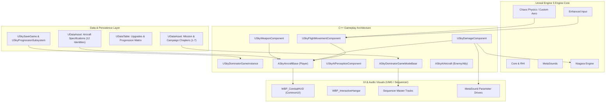

# SKY DOMINATOR: APEX STRIKE
## Technical Design Document (TDD) & Pre-Production Architecture

---

### 1. Executive Summary & Technology Selection

| Dimension | Specification | Rationale |
| :--- | :--- | :--- |
| **Project Title** | SKY DOMINATOR: APEX STRIKE | High-concept, cinematic military aerial combat IP |
| **Engine** | Unreal Engine 5 (UE 5.4+ target) | Industry gold standard for PBR rendering, Nanite/Lumen scalability, Niagara VFX, MetaSounds, and cross-platform compilation |
| **Primary Language** | C++ (Core Engine & Systems) + Blueprints (Scripting & UI) | Strict separation: C++ handles physics, calculations, networking/subsystems, AI perception tick, save serialization; Blueprints handle visual tuning, sequencer triggers, UI event dispatching |
| **Target Platforms** | Windows PC (D3D12/Vulkan), Android (Vulkan/OpenGL ES 3.2), iOS (Metal), macOS (Metal), Future Consoles (PS5/Xbox Series X|S) | Scalable single codebase architecture with automated device profiles |
| **Control Systems** | Enhanced Input Subsystem | Native multi-platform context mapping (Virtual Touch, Gamepad, Flight Stick/HOTAS, Keyboard & Mouse) |
| **Audio Architecture**| MetaSounds + Spatial Audio Buses | Dynamic parameter-driven cockpit, G-force, wind resistance, engine RPM synthesis |
| **VFX Engine** | Niagara VFX System | Scalable particle simulations (missile smoke trails, afterburner Mach diamonds, dynamic damage sparks) |

---

### 2. Complete System Architecture & Modular Design

---

### 3. Comprehensive Aircraft Data Model

The game establishes **12 distinct fictional aircraft identities**, designed with specific tactical silhouettes, flight dynamics, and fictional combat systems:

| ID | Codename | Aircraft Class | Wings & Silhouette | Max Mach | Turn Rate | Armor | Special Signature Ability |
| :--- | :--- | :--- | :--- | :--- | :--- | :--- | :--- |
| **A-01** | *Apex Phantom* | Stealth Interceptor | Internal bays, diamond delta | Mach 2.8 | Very High | Medium | **Active Cloak**: Radar break & IR suppression for 8s |
| **A-02** | *Titan Breaker* | Heavy Strike Fighter | Broad twin-fuselage, titanium nose | Mach 1.9 | Moderate | Ultra High | **Overcharged Aegis**: Frontal energy barrier absorbs 70% damage |
| **A-03** | *Valkyrie IX* | Advanced Multirole | Forward-swept variable wings | Mach 2.4 | High | High | **Omni-Burst**: Multi-lock kinetic micro-missile salvo |
| **A-04** | *Hyperion Velocity*| High-Speed Experimental | Needle-nosed lifting body, scramjet | Mach 3.6 | Low (Hi-Spd) | Low | **Supercruise Surge**: 300% thrust acceleration burst |
| **A-05** | *Trident Corsair* | Naval Carrier Fighter | Folding gull wings, reinforced gear | Mach 2.2 | High | High | **Sea-Skimmer Jammer**: Surface clutter deception radar |
| **A-06** | *Specter ECM* | Electronic Defense | Dorsal radome spine, antennae | Mach 2.0 | Medium | High | **EMP Disruption Wave**: Disables enemy lock-on in 2km radius |
| **A-07** | *Raven Eye* | Tactical Recon Jet | High-aspect ultra-thin wing | Mach 2.6 | Moderate | Low | **Battlefield Horizon**: Thermal & radar vision through all clouds |
| **A-08** | *Solaris Wing* | Elite Squadron Fighter | Dual vertical canards, swept delta | Mach 2.5 | Superior | Medium | **Vector Thrust Override**: Instant post-stall 180° Kulbit flip |
| **A-09** | *Chronos Hypersonic*| Hypersonic Concept | Wave-rider waverider fuselage | Mach 4.2 | Low | Medium | **Kinetic Sonic Shockwave**: Atmospheric wake damages tail pursuers |
| **A-10** | *Colossus Juggernaut*| Heavy Armored Aircraft | Quad-turbine, reinforced composite | Mach 1.6 | Low | Maximum | **Point-Defense Fortress**: Automated CIWS flak intercepts missiles |
| **A-11** | *Night Wraith* | Legendary Phantom Fighter | Faceted composite, blended wing | Mach 2.7 | Very High | Medium | **Shadow Step**: Optical decoy illusion deployed to confuse AI |
| **A-12** | *Sky Dominator (Apex)*| Ultimate Apex Aircraft | Adaptive morphing nanotech aero | Mach 3.2 | Maximum | Extreme | **Apex Overdrive**: Unlimited energy, hyper-agility, triple cannon |

---

### 4. Advanced Flight Physics Architecture

The flight simulation model operates on continuous physical forces rather than simple translation transforms. It computes real-time aerodynamic equations per tick:

$$\vec{F}_{\text{total}} = \vec{F}_{\text{thrust}} + \vec{F}_{\text{lift}} + \vec{F}_{\text{drag}} + \vec{F}_{\text{gravity}}$$

1. **Thrust ($\vec{F}_{\text{thrust}}$)**:
   - Driven by throttle setting ($0.0 \to 1.0$) and Afterburner boost ($1.0 \to 1.8$).
   - Subject to altitude density scaling $\rho(h) = \rho_0 e^{-h / h_{\text{scale}}}$.
   - Engine thermal accumulation model: Sustained afterburner increases core temperature; exceeding $1100^\circ\text{C}$ triggers thermal throttling and warning Klaxon.

2. **Aerodynamic Lift ($\vec{F}_{\text{lift}}$)**:
   - $L = \frac{1}{2} \rho v^2 S C_L(\alpha)$
   - Angle of Attack ($\alpha$) dynamically affects $C_L$.
   - **Stall Mechanics**: When $\alpha > \alpha_{\text{critical}}$ ($\sim 24^\circ$ depending on handling profile), $C_L$ plummets and buffeting / vibration begins.
   - Ground effect: Lift increases by up to 25% when altitude above terrain is less than wingspan $b$.

3. **Aerodynamic Drag ($\vec{F}_{\text{drag}}$)**:
   - $D = \frac{1}{2} \rho v^2 S \left(C_{D0} + \frac{C_L^2}{\pi e AR}\right) + D_{\text{transonic}}$
   - Transonic wave drag spike between Mach 0.9 and Mach 1.2 with visual Prandtl-Glauert vapor cone effect.

4. **Handling Profiles (User-Selectable)**:
   - **Beginner**: Automatic pitch/roll auto-leveling, stall-prevention limiter, auto-rudder coordination.
   - **Advanced**: Full manual 3-axis rotation, G-force limiters active, manual airbrake.
   - **Simulation**: Authentic inertia tensor, true aerodynamic cross-coupling, high-G blackout/redout effects, manual trim.

---

### 5. Multiplatform Input & Enhanced Input Mapping

| Action | PC (Keyboard & Mouse) | Gamepad (Xbox / PS5 / Switch) | Mobile (Virtual Touch & Gyro) |
| :--- | :--- | :--- | :--- |
| **Pitch & Roll** | Mouse Y / X or W/S & A/D | Left Thumbstick (Y / X) | Virtual Analog Joystick (Left Screen) or Device Tilt (Gyro) |
| **Yaw (Rudder)** | Q / E Keys | Left & Right Bumpers (LB / RB) | Horizontal Rudder Slider or Auto-Coordinated |
| **Throttle / Brake** | Shift / Ctrl or Mouse Wheel | Right Trigger (RT) / Left Trigger (LT) | Vertical Throttle Slider with Afterburner Detent |
| **Primary Fire (Cannon)** | Left Mouse Button | Right Trigger (Half-pull / Button) | Floating Touch Fire Button (Right Screen) |
| **Secondary (Missiles)** | Right Mouse Button / Space | Right Face Button (B / Circle) | Dedicated Missile Launch Button with Lock Ring |
| **Target Lock Cycle** | Tab / Middle Mouse | 'Y' / Triangle | Tap Target on Screen / Screen Reticle Icon |
| **Defensive Countermeasures** | 'C' Key | 'X' / Square | Chaff/Flare Quick Tap Icon |
| **Special Aircraft Ability** | 'F' Key | Left Stick Click (L3) + R3 | Special Power Hexagon Button |
| **Camera View Cycle** | 'V' Key (Cockpit, Chase, Orbit) | D-Pad Down | Camera Switch Button |

---

### 6. Damage & Health Architecture

Aircraft condition is partitioned into critical modular subsystems:
1. **Structural Hull (Main HP)**: Overall integrity. Reaching 0 initiates structural breakup and catastrophic explosion.
2. **Left / Right Wing Subsystems**: Wing damage causes asymmetrical lift, inducing a roll bias and reduced maximum G-load.
3. **Twin Propulsion Cores (Engines)**: Partial damage produces dark smoke, reduced top speed, and slower acceleration. Full flameout requires gliding restart.
4. **Avionics & Radar Radome**: Damaged avionics cause HUD flickering, static noise, radar range degradation, and delayed lock-on acquisition.
5. **Control Surfaces (Ailerons / Elevators / Rudder)**: Severe hits reduce angular acceleration rates.

**Collectible Battlefield Boosters**:
- `BP_Booster_Health`: Rapid nanite repair restored 35% hull.
- `BP_Booster_Armor`: Hardens kinetic deflection by 50% for 15s.
- `BP_Booster_Energy`: Overfills afterburner boost tank instantly.
- `BP_Booster_Shield`: 360-degree electromagnetic bubble absorbing the next 3 incoming missile strikes.
- `BP_Booster_EmergencyRepair`: Resets wing roll trim and clears engine fire.
- `BP_Booster_ExtraLife`: Grants instant mid-air tactical respawn without resetting mission checkpoint.

---

### 7. Mission & Campaign Architecture ("The Last Sky")

7 Fully Structured Campaign Chapters:
1. **Chapter 01: First Flight** (Apex Base, Tropical Atoll) - Systems familiarization, canyon navigation, drone target trial.
2. **Chapter 02: Dark Horizon** (Desert Military Sector) - Hostile radar installation strikes, first fighter squadron dogfight.
3. **Chapter 03: Storm Breaker** (Supercell Cloud Frontier) - Lightning avoidance, low-visibility sensor tracking, high-altitude dogfighting.
4. **Chapter 04: Lost Squadron** (Arctic Mountain Fjord) - Search & rescue escorting damaged allied transport under intense anti-air flak.
5. **Chapter 05: Iron Fortress** (Futuristic Coastal Megacity) - Intercepting massive airborne dreadnought fortress and its escort swarm.
6. **Chapter 06: Shadow Protocol** (Nighttime Volcanic Trench) - Stealth infiltration beneath enemy radar floor, sabotage of prototype weapons.
7. **Chapter 07: Final Horizon** (Orbital Edge & Apex Facility) - Climactic multi-phase confrontation against Ace Rival "Vanguard Zero" and the Prototype Sky Dominator.

---

### 8. Platform Compatibility Matrix

| Feature | Android / iOS (Mobile) | Windows PC (Mid/High) | Windows PC (Ultra) / Console |
| :--- | :--- | :--- | :--- |
| **Rendering API** | Vulkan / Metal (ES 3.2 fallback) | DirectX 12 / Vulkan | DirectX 12 Agility SDK |
| **LOD Strategy** | 4-level Skeletal LODs, Mesh Decimation | Nanite Mesh Virtualization | Full Nanite + 8K Virtual Textures |
| **Lighting** | Mobile Clustered Forward / Screen AO | Lumen Software Ray Tracing | Lumen Hardware Ray Tracing + MegaLights |
| **Atmosphere** | Static Cube Clouds / Optimized Fog | Volumetric Cloud System | 3D Volumetric Cloud Lighting with Storm Ray-March |
| **Shadows** | Cascade Shadow Maps (CSM) 2k | Virtual Shadow Maps (VSM) | Virtual Shadow Maps + Contact Hardening |
| **Target Frame Rate**| 30–60 FPS (Dynamic Resolution) | 60–120 FPS at 1440p | 60–144 FPS at 4K Native |

---

### 9. Complete Development Milestones & Roadmap

- **Phase 1: Project Foundation & Technical Framework** *(Current Step)*
- **Phase 2: First Playable Aircraft & Flight Dynamics Engine**
- **Phase 3: Interactive Aircraft Hangar & 3D Customization Center**
- **Phase 4: Combat Systems, Missile Tracking & Fictional Weapons**
- **Phase 5: Intelligent Enemy AI Pilot Behaviors & Squadron Flocking**
- **Phase 6: Progression, Economy, Boosters & Save Architecture**
- **Phase 7: Story Campaign "The Last Sky" Mission 01 Integration**
- **Phase 8: Environment, Dynamic Atmosphere, VFX & Post-Processing**
- **Phase 9: Comprehensive Audio Synthesis & CommonUI Polishing**
- **Phase 10: Multi-Platform Packaging, Mobile Optimization & Certification**
- **Phase 11: QA Test Matrix, Automation Framework & Regression Suite**
- **Phase 12: Release Candidate Deployment & Master Store Gold Master**

---
*Authored by: Sky Dominator Lead Technical Architecture Team*

